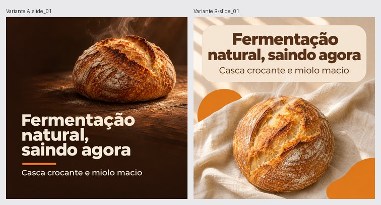

# Skill: Conteúdo para Redes Sociais (PT-BR, imagens pelo Codex)

Skill para o [Claude Code](https://claude.com/claude-code) que cria **carrosséis,
posts, stories, capas, thumbnails, legendas e hashtags** para Instagram,
LinkedIn, X, Facebook, TikTok, YouTube e Pinterest, em português.

**O Claude pensa, o Codex desenha.** O Claude cuida da estratégia, da copy, do
sistema visual e dos prompts. **Todas as imagens finais são geradas pelo
[Codex CLI](https://github.com/openai/codex)** (ChatGPT / gpt-image), usando a
sua assinatura do ChatGPT, sem chave de API.

| Quem | Faz |
|---|---|
| Claude | briefing, roteiro, paleta e tipografia, `plano.json` com os prompts, revisão do texto nas imagens, legenda e hashtags |
| Codex | gera e edita todas as imagens (`image_gen`) |
| Scripts | chamam o Codex, cortam no tamanho exato, montam prévia, folha de revisão e PDF |

## Modos

| Modo | Para quê |
|---|---|
| **Carrossel** | educativo, lista, tutorial, história. Barra de progresso, contador e seta na arte; estilo idêntico em todos os slides |
| **Post / peça única** | feed, story, thumbnail, pin |
| **Anúncio (Meta ADS)** | lote de criativos, cada um com ângulo, imagem, headline e design próprios; logo sem distorção, tag de cidade (se local), grafismo de apoio e botão de CTA |
| **Variantes A/B** | o mesmo texto em dois designs totalmente diferentes, cada um partindo de uma referência, para o cliente escolher |
| **Orgânico enxuto** | só headline + subheadline na arte, sem logo; CTA e cidade na legenda |

## O que ela faz

- **Briefing rápido**: pergunta só o que falta e infere o resto.
- **Roteiro primeiro**: copy slide a slide (gancho, uma ideia por slide, CTA), aprovada antes de gastar cota de imagem.
- **Sistema visual**: paleta derivada de uma cor, estilo tipográfico e uma frase de estilo única para manter o carrossel coeso.
- **Estruturas prontas**: 7 slides padrão, lista/dicas, tutorial, história, antes/depois, comparação, curadoria.
- **Geração pelo Codex**: o slide 1 é gerado primeiro e serve de referência de estilo para os demais. Os outros rodam em paralelo.
- **Texto em português exato**: o prompt lista cada texto verbatim. Depois, o Claude confere letra por letra (acentos, ç) e corrige com edição pontual.
- **Barra de progresso, contador "n/N" e seta de swipe** na própria arte; o último slide sai sem seta.
- **Tamanho exato**: 1080×1350, 1080×1080, 1080×1920, 1200×675, 1280×720, 1200×627 e 1000×1500.
- **Revisão**: prévia deslizável com moldura do Instagram, folha de contato e ajustes só nos slides pedidos, com versões guardadas.
- **Entrega**: PNGs, PDF para carrossel do LinkedIn, legenda, hashtags e texto alternativo.

## Exemplos reais (gerados pelo Codex com esta skill)

**Carrossel**: 3 slides, texto em português correto já na primeira geração; o
slide 1 serviu de referência de estilo para os outros.


**Ajuste pontual** (`--ajustar 3`): só o texto do botão mudou, o resto da arte foi preservado.


**Variantes A/B**: mesmo texto, dois designs, cada um a partir de uma referência.



**Peça única** (thumbnail de YouTube, 1280×720):


## Estrutura

```
conteudo-redes-sociais/              ← a skill (pasta do repositório viskoo-skills)
├── viskoo.json                      manifesto da plataforma Viskoo IA (botão, entradas, saídas)
├── SKILL.md                         fluxo em 8 passos + checklist
├── references/
│   ├── codex.md                     schema do plano.json, prompts, ajustes, problemas
│   ├── plataformas.md               dimensões, zonas seguras, formatos do script
│   ├── carrossel.md                 ganchos, sequências, psicologia do swipe
│   ├── design.md                    paleta, tipografia, contraste
│   └── copy-legendas.md             ganchos, legenda, CTA, hashtags
├── assets/
│   ├── exemplo-plano.json           carrossel de 7 slides
│   ├── exemplo-plano-anuncio.json   lote de anúncios Meta ADS (1:1 e 9:16)
│   ├── exemplo-plano-ab.json        post orgânico com variantes A/B
│   └── template-carrossel.html      rascunho de layout opcional (referência p/ Codex)
├── scripts/
│   ├── gerar_com_codex.py           plano.json → Codex → PNGs no tamanho exato
│   ├── montar_previa.py             prévia deslizável + folha.png + PDF
│   ├── exportar_slides.py           rascunho HTML → PNG (referência de layout)
│   └── embutir_imagem.py            imagem → data URI (para o rascunho HTML)
├── fontes/                          skills originais baixadas (só referência)
└── docs/exemplos/                   imagens de exemplo geradas pelo Codex
```

## Instalação

1. **Codex CLI** logado com sua conta ChatGPT:
   ```bash
   npm i -g @openai/codex
   codex login                 # escolha "Sign in with ChatGPT"
   codex login status          # → Logged in using ChatGPT
   ```
   A geração de imagens usa a cota da sua assinatura do ChatGPT.

2. **Pillow** (para cortar e montar a prévia):
   ```bash
   pip install pillow
   ```
   Opcional, só para o rascunho HTML: `pip install playwright && python3 -m playwright install chromium`.

3. **A skill**, para todos os projetos:
   ```bash
   mkdir -p ~/.claude/skills
   ln -s "$PWD/viskoo-skills/conteudo-redes-sociais" ~/.claude/skills/conteudo-redes-sociais
   ```
   Ou copie para `.claude/skills/` dentro de um projeto.

## Como usar

Peça em linguagem natural no Claude Code:

> Faz um carrossel sobre 5 erros de precificação para freelancers. Marca "Preço Justo", @precojusto, cor #2F6FEB, tom didático, ilustrações flat.

> Cria uma thumbnail de YouTube e um story anunciando nosso webinar de quinta. A foto do apresentador está em ./fotos/ana.jpg.

Fluxo: **briefing → roteiro (você aprova) → plano.json → Codex gera → Claude
revisa e corrige → prévia para você → ajustes → "aprovado" → PNGs, PDF e legenda**.

### Rodando os scripts manualmente

```bash
mkdir -p posts/meu-tema
cp conteudo-redes-sociais/assets/exemplo-plano.json posts/meu-tema/plano.json
# edite o plano (marca, estilo, slides, textos)

S=conteudo-redes-sociais/scripts
python3 $S/gerar_com_codex.py posts/meu-tema/plano.json --prompts   # confere os prompts (grátis)
python3 $S/gerar_com_codex.py posts/meu-tema/plano.json -j 2        # gera com o Codex
python3 $S/montar_previa.py posts/meu-tema --pdf                    # prévia, folha e PDF

# ajustes
python3 $S/gerar_com_codex.py posts/meu-tema/plano.json --ajustar 3 \
  --instrucao 'change only the button text to "Quero mais dicas"'
python3 $S/gerar_com_codex.py posts/meu-tema/plano.json --slides 4  # regenera do zero
```

Resultado em `posts/meu-tema/`:

```
slides/slide_01.png …   finais no tamanho exato
bruto/                  originais do Codex + versões anteriores (_v1, _v2…)
prompts/ logs/          prompt enviado e eventos do Codex por slide
previa.html folha.png carrossel.pdf
```

Cada imagem leva cerca de 1 minuto. Use `-j 2` ou `-j 3` para paralelizar.
Planos com variantes salvam em `variante-A/`, `variante-B/` e geram
`folha-variantes.png` para comparar; `--variante B` refaz só uma delas.

Sem o Codex CLI, os arquivos de `prompts/` (gerados com `--prompts`) podem ser
colados direto no ChatGPT, anexando as imagens de referência na ordem indicada.

## Skills de origem

As versões originais estão em [`fontes/`](fontes/):

| Skill | Autor | O que foi aproveitado |
|---|---|---|
| [social-media-carousel](https://github.com/inference-sh/skills/tree/main/guides/social/social-media-carousel) | inference.sh | Framework de 7 slides, tipos de gancho e de carrossel, psicologia do swipe, legibilidade, erros comuns |
| [ai-social-media-content](https://github.com/inference-sh/skills/tree/main/guides/social/ai-social-media-content) | inference.sh | Formatos por rede, fórmulas de gancho, legendas/hashtags, reaproveitamento multi-rede, geração em lote |
| [social-graphics](https://github.com/sanky369/vibe-building-skills/tree/main/skills/creative/social-graphics) (MIT) | sanky369 | Princípio dos 2 segundos, briefing sem travar, copy antes do visual, prompt estruturado, checklist |
| [instagram-carousel](https://github.com/marcolang/marketing-skills/tree/main/instagram-carousel) | marcolang | Paleta de uma cor, pares de fontes, barra de progresso e seta, moldura do Instagram, fluxo de revisão, ajuste só do slide pedido |
| Criativo de Imagem (`fontes/julio-savio/`) | Julio Sávio | Modo anúncio (ângulos diferentes por criativo, logo sem distorção, tag de cidade só se local, grafismo de apoio, CTA, revisão ortográfica), variantes A/B com referência, orgânico enxuto, regras contra ícones soltos, travessão e números inventados |

A página de review do Tessl estava fora do ar (404) e se refere à mesma `social-media-carousel`.

## Licença

Os arquivos em `fontes/` pertencem aos respectivos autores. `social-graphics` é
MIT; os repositórios da inference.sh e da marcolang não declaram licença no
GitHub.
